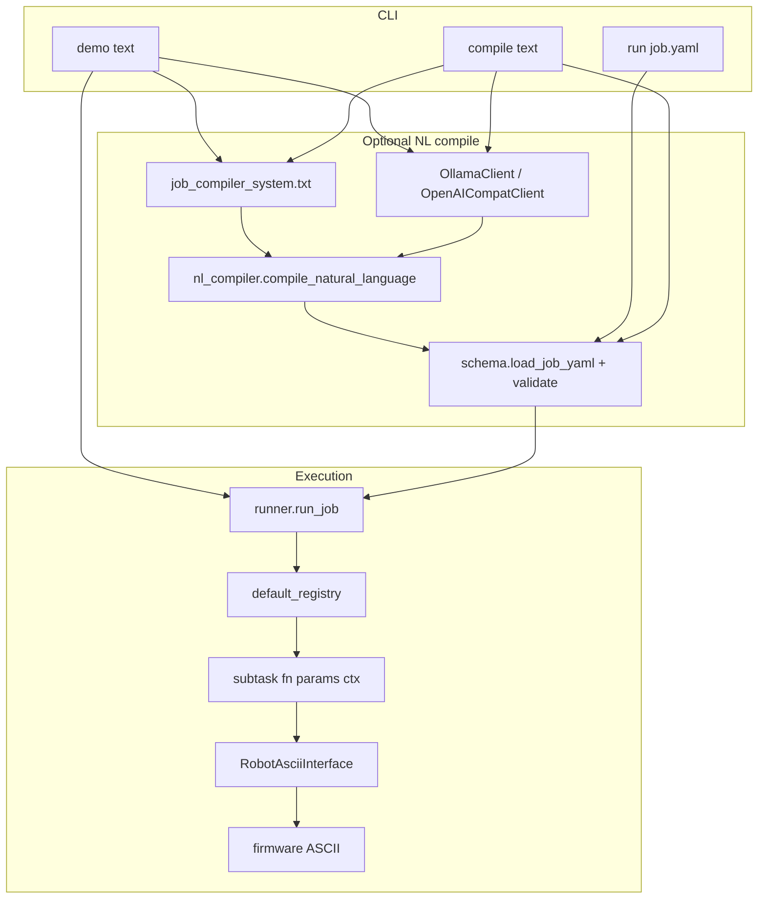

# High-level jobs framework

Layer 0 task orchestration for the Dummy tabletop robot: **YAML/JSON job specs**, a **small state machine runner**, **pluggable subtask actions**, and an optional **NL → job** compile step via a local or hosted LLM.

The LLM does **not** talk to the robot. It only produces a validated **job document**. Execution is always deterministic Python → `RobotAsciiInterface` → serial ASCII.

---

## Quick start

Run from the `software/` directory (so `high_level_jobs` and `robot_ascii_interface` import cleanly):

```powershell
cd c:\Users\PQE_339_ThinkPad\Documents\Dummy_lab\software

# Hand-written job, real hardware
python -m high_level_jobs run high_level_jobs/jobs/examples/go_home_robot.yaml --robot-port COM3 --execute

# Natural language → compile → run (requires Ollama or OpenAI-compatible API)
python -m high_level_jobs demo "go to home position" --robot-port COM3 --backend ollama

# NL → YAML only (no robot)
python -m high_level_jobs compile "go to home position" --out high_level_jobs/jobs/generated/plan.yaml --backend ollama
```

**Dependencies:** `PyYAML`, `pyserial`, package `software/robot_ascii_interface`.

**Dry-run:** `run` defaults to dry-run unless `--execute`. `demo` hits hardware by default; use `--dry-run` to test LLM output only.

---

## Architecture



### End-to-end path (YAML → serial)

1. **Parse:** `load_job_yaml(text)` → in-memory `JobSpec` (states, steps, transitions).
2. **Repair (optional):** `_inject_missing_go_home_chain` fills missing edges for the standard go-home state names.
3. **Validate:** every non-terminal state must have an outgoing `(state, "done")` transition.
4. **Run:** `run_job(spec, registry, ctx=...)` walks states; each step calls `registry[action](params, ctx)`.
5. **Robot steps:** `robot_*` actions use `ctx["robot"]` (`RobotAsciiInterface`) to send lines like `!START`, `!HOME`.

---

## Directory layout

| Path | Role |
|------|------|
| `cli.py` | Entry: `run`, `demo`, `compile` subcommands |
| `schema.py` | `JobSpec` dataclasses, YAML load/validate, go-home repair |
| `runner.py` | State machine: run steps, follow `done` transitions |
| `nl_compiler.py` | Human text → LLM → JSON → `JobSpec` |
| `llm_client.py` | `OllamaClient`, `OpenAICompatClient` |
| `prompts/job_compiler_system.txt` | System prompt: allowed actions + JSON shape |
| `subtasks/builtins.py` | `log_message`, `wait_seconds` |
| `subtasks/robot_actions.py` | `robot_check_connected`, `robot_ensure_enabled`, `robot_home` |
| `subtasks/registry.py` | Merges builtins + robot + `CUSTOM_SUBTASKS` |
| `jobs/examples/` | Hand-written reference jobs |

---

## Core concepts

### Registry vs `ctx`

| | **Registry** | **`ctx`** |
|---|--------------|-----------|
| What | `action` string → Python callable | Mutable dict, one per job run |
| Set by | Code (`default_registry()`) | CLI + `run_job` defaults; subtasks update it |
| Purpose | “What function runs for this step?” | “How this run behaves + shared handles” |
| From YAML? | Only the **name** in `action:` | No (not part of job file) |

Every subtask signature: **`fn(params: Mapping, ctx: dict) -> None`**.

### `ctx` keys (typical)

| Key | Set by | Meaning |
|-----|--------|---------|
| `dry_run` | CLI | If true, robot/builtin sleeps are no-ops |
| `verbose` | CLI | Print user-facing status from subtasks |
| `robot_port` | CLI / env `ROBOT_PORT` | Default COM port |
| `robot_baudrate` | CLI / env `ROBOT_BAUDRATE` | Default baud |
| `robot` | `robot_check_connected` | Shared `RobotAsciiInterface` instance |

Inspect after a run: `run_job` returns `ctx`; `run_job_file` returns `(spec, ctx)`.

### State machine rules (`runner.py`)

1. Start at `initial_state`.
2. Run **all** `steps` in the current state (in order).
3. If state is in `terminal_states` → **stop** (steps already ran).
4. Else follow transition `(current_state, "done")` → next state.
5. If no `done` transition → **stop** (log and exit).

Only event **`done`** is used today. Richer events (error, retry) would require runner changes.

---

## Job YAML schema

Top-level fields:

```yaml
job_id: my_job
initial_state: FIRST

states:
  FIRST:
    description: optional note
    steps:
      - action: registered_action_name
        params: { key: value }

transitions:
  - from: FIRST
    event: done
    to: SECOND

terminal_states:
  - END
```

- **JSON is valid YAML** — compiled jobs can be saved as `.json` or `.yaml`.
- Every **non-terminal** state needs a transition with `"event": "done"`.
- **Terminal** states still run their steps; they just have no outgoing `done` edge.

Reference example: `jobs/examples/go_home_robot.yaml`.

---

## Registered actions

### Builtins (`subtasks/builtins.py`)

| Action | Params | Notes |
|--------|--------|-------|
| `log_message` | `{ text: "..." }` | Logs + optional print |
| `wait_seconds` | `{ seconds: 0.1 }` | Skipped when `dry_run` |

### Robot (`subtasks/robot_actions.py`)

Requires prior steps as noted. Uses `software/robot_ascii_interface`.

| Action | Params | Firmware / serial |
|--------|--------|-------------------|
| `robot_check_connected` | `port`, `baudrate`, `auto_connect` (optional) | Opens serial |
| `robot_ensure_enabled` | `{}` | `!START` |
| `robot_home` | `command_wait_ms` (default 1500), `read_extra_sec` (default 30), `wait_motion`, `motion_timeout_sec` | `!HOME` |

**Go-home sequence (recommended order):** `robot_check_connected` → `robot_ensure_enabled` → `robot_home`.

`read_extra_sec` is passed to `RobotAsciiInterface.send_command` as extra time to poll for a line after `!HOME` (slow MCU replies).

### Adding a new action

1. Implement `def my_action(params, ctx): ...` in a subtasks module.
2. Register in `subtasks/registry.py` → `CUSTOM_SUBTASKS["my_action"] = my_action`.
3. Document the name and params in `prompts/job_compiler_system.txt` if the LLM should emit it.
4. Add an example step in `jobs/examples/` if useful.

---

## CLI reference

### `run`

```text
python -m high_level_jobs run PATH.yaml [--execute] [--quiet] [--robot-port COM3] [--robot-baudrate 115200]
```

- Default: **dry-run** (no serial/motion).
- `--execute`: real hardware; disconnects serial after run if opened.

### `demo`

```text
python -m high_level_jobs demo "natural language" [--backend ollama|openai] [--model NAME]
  [--save-yaml PATH] [--dry-run] [--quiet] [--robot-port COM3]
```

- Compiles NL with LLM, then runs immediately.
- `--save-yaml`: persist compiled plan for editing/replay with `run`.

### `compile`

```text
python -m high_level_jobs compile "text" --out PATH.yaml [--backend ollama|openai] [--file PATH]
```

- NL → validated YAML only; no robot.

### Environment

| Variable | Used by |
|----------|---------|
| `ROBOT_PORT`, `ROBOT_BAUDRATE` | CLI defaults |
| `OLLAMA_HOST`, `OLLAMA_MODEL` | `OllamaClient` |
| `OPENAI_API_KEY`, `OPENAI_BASE_URL`, `OPENAI_MODEL` | `OpenAICompatClient` |

---

## Natural language compile

**Not** template selection. The model **generates** a full JSON job constrained by the system prompt.

Flow (`nl_compiler.py`):

1. Load `prompts/job_compiler_system.txt`.
2. User message = fixed instructions + human command.
3. `client.complete(system, user)` → string (JSON).
4. `_extract_json_object` strips markdown fences if present.
5. `load_job_yaml(blob)` → validate (+ go-home repair).
6. On failure: up to **2** repair attempts with error text fed back to the model.

**Without Ollama:** use Cursor chat to produce JSON matching the prompt, save as `.yaml`/`.json`, then `run`. Or use `--backend openai` with an API key.

**Go-home repair (`schema._inject_missing_go_home_chain`):** if states include the standard names `CONNECT`, `ENABLE`, `MOVE_HOME`, `END`, missing `done` edges and missing `END` in `terminal_states` are auto-filled before validation.

---

## Relationship to other `software/` packages

| Package | Layer | Role |
|---------|-------|------|
| `high_level_jobs` | 0 | Job sequencing, NL compile, subtask registry |
| `robot_ascii_interface` | Execution | Serial ASCII protocol (`!HOME`, `&` waypoints, …) |
| `manual_control` | Teleop | PyBullet IK + keyboard streaming (separate from jobs) |
| `trajectory_planner` / `trajectory_run` | 1–2 | Planned paths and playback (future subtask hooks) |

Future subtasks might call trajectory playback, vision servo, or ONNX policies; register them in `CUSTOM_SUBTASKS` and extend the system prompt.

---

## Troubleshooting

| Symptom | Likely cause | What to do |
|---------|--------------|------------|
| Ollama connection refused | Server not running | Start Ollama app or `ollama serve`; `ollama pull llama3.2` |
| Validation: missing `done` transition | Bad LLM graph | Use `go_home_robot.yaml`; or rely on go-home repair; improve prompt/model |
| Stops after CONNECT | No `(CONNECT, done)` transition | Same as above; inspect with `--save-yaml` |
| `!HOME returned no response` | Serial read timeout | Increase `read_extra_sec` / `command_wait_ms` in `robot_home` params |
| Action not found | Unregistered `action` | Add to `registry.py` |
| Import errors | Wrong cwd | Run from `software/` or set `PYTHONPATH` |

---

## Design notes (for future agents)

1. **Separation:** LLM = compiler front-end; runner = deterministic executor; firmware = real-time motion.
2. **Extend via registry**, not by editing the runner, unless adding new transition events.
3. **Prefer hand-written YAML** for production-critical sequences; use NL for prototyping.
4. **Validate early:** `load_job_yaml` is the single gate for both files and LLM output.
5. **Shared robot handle:** one `ctx["robot"]` per run; CLI disconnects after `--execute` / non–dry-run `demo`.

---

## Example: extend with a new subtask

```python
# subtasks/my_skill.py
def run_vision_servo(params, ctx):
    if ctx.get("dry_run"):
        return
    # open camera, PID loop, write deltas via ctx["robot"] ...

# subtasks/registry.py
from high_level_jobs.subtasks.my_skill import run_vision_servo
CUSTOM_SUBTASKS["run_vision_servo"] = run_vision_servo
```

Then add to `job_compiler_system.txt` and reference in job YAML:

```yaml
- action: run_vision_servo
  params:
    target: bead
```
