# Grab sensor — vision + grasp pipeline

Pick the **table workpiece (sensor)** using a fixed Intel RealSense D415. The camera is not the pick target; it locates the object each cycle. A one-time **`camera_to_robot`** calibration maps camera coordinates to the robot planner frame.

## Pipeline overview

```mermaid
flowchart LR
  A[D415 RGB + depth] --> B[YOLO full frame]
  B --> C[Sensor bounding box]
  C --> D[Crop RGB + depth]
  D --> E[Grasp CNN RGBD]
  E --> F[Grasp pixel in full image]
  F --> G[Depth → 3D camera frame]
  G --> H[camera_to_robot]
  H --> I[Pre-grasp + grasp poses]
  I --> J[iLQR plan + execute]
```



### Stage 1 — Object detection (YOLO)

- **Input:** full 640×480 color frame  
- **Output:** bounding box for class `sensor`  
- **Model:** `dataset/grasp_keypoints/model/sensor_yolo.pt` (Ultralytics YOLOv8n, fine-tuned locally)

### Stage 2 — Grasp point (RGB + depth CNN)

- **Input:** crop inside YOLO box (+ padding), **4 channels** (RGB + normalized depth)  
- **Output:** grasp pixel `(u, v)` in crop space → mapped to full image  
- **Model:** `dataset/grasp_keypoints/model/grasp_point.pt`  
- Depth at that pixel → 3D point in the camera frame  

### Stage 3 — Robot grasp

- **`grasp_orientation_mode: fixed_robot`** — grasp **XYZ** from vision; gripper orientation from config (not object PCA)  
- **`camera_to_robot`** — fixed mount calibration (must be tuned for your cell)  
- iLQR plans pre-grasp → grasp → (optional) execute on robot  

#### Fixed orientation with XY heading (`fixed_robot`)

Vision supplies grasp **position** only. Orientation is planner **world RPY** (deg in config, rad for IK):

1. Template: `fixed_grasp_rpy_world_deg: [0, 0, 0]` — level tool in world frame (no extra 180°; the planner already loads the robot with base Z rotated 180°).

2. With `grasp_c_from_xy: true`, only yaw changes:

   ```text
   yaw_grasp = yaw_template + grasp_xy_yaw_sign * atan2(Y, X)
   ```

   Flip `grasp_xy_yaw_sign` between `1` and `-1` if the tool spins the wrong way.

Set `grasp_c_from_xy: false` to keep the template everywhere.

Legacy mode **`vision_mode: depth_segment`** uses depth band + blob + PCA instead of YOLO + CNN.

## Quick start

All commands from `software/`:

```powershell
# Live detection + debug overlay
python -m high_level_jobs.subtasks.grab_sensor --detect-only --visualize

# Offline (no D415): last saved debug capture in grab_sensor/debug/
python -m high_level_jobs.subtasks.grab_sensor --offline --detect-only --visualize

# Plan + PyBullet path playback (offline test capture, no robot motion)
python -m high_level_jobs.subtasks.grab_sensor --offline --plan-gui --visualize

# Drag world roll/pitch/yaw sliders; sphere + RGB axes at origin (no URDF)
python -m high_level_jobs.subtasks.grab_sensor.rpy_world_viz

# Or explicit files from a prior run
python -m high_level_jobs.subtasks.grab_sensor --visualize \
  --color-file high_level_jobs/subtasks/grab_sensor/debug/grab_sensor.color.png \
  --depth-file high_level_jobs/subtasks/grab_sensor/debug/grab_sensor.depth.npy

# Full plan (add --execute --port COM3 to run on robot)
python -m high_level_jobs.subtasks.grab_sensor --offline --visualize
```

Debug outputs (local only, not in git):

- `grab_sensor/debug/grasp_overlay.png` — YOLO box, NN grasp (red), robot reprojection (magenta if miscalibrated)  
- `grab_sensor/debug/detection.json` — numeric results  

## Configuration

Primary file: `config/default_grasp.yaml`

| Key | Purpose |
|-----|---------|
| `vision_mode` | `yolo_grasp` (default) or `depth_segment` |
| `camera_to_robot` | Fixed D415 mount (calibrate once) |
| `yolo.*` | YOLO weights, confidence, crop padding |
| `grasp_net.*` | Grasp CNN weights, depth normalization band |
| `grasp_orientation_mode` | `fixed_robot` or `follow_object` |
| `fixed_grasp_rpy_world_deg` | World RPY template `[0,0,0]` deg; yaw ± `atan2(Y,X)` when `grasp_c_from_xy` |
| `grasp_c_from_xy` | If true: `yaw += sign * atan2(Y,X)`; see Stage 3 |
| `grasp_xy_yaw_sign` | `1` = add atan2, `-1` = subtract (default `-1`) |
| `load_environment` | `false` = robot-only PyBullet scene (default for grasp planning) |
| `approach.*` | Pre-grasp offset, retreat after close |

## Data collection & training

Training data stays **local** under `dataset/` (see `dataset/README.md`). It is not committed to git.

### 1. Label grasp points (interactive)

```powershell
pip install opencv-python pyrealsense2 torch
python -m high_level_jobs.subtasks.grab_sensor.label_grasp
```

Click grasp point → **S** save → adjust scene → repeat.

### 2. Train YOLO sensor detector

Bootstrap bbox labels from grasp clicks, then train:

```powershell
pip install ultralytics
python -m high_level_jobs.subtasks.grab_sensor.export_yolo_dataset
python -m high_level_jobs.subtasks.grab_sensor.train_yolo_model --export-first
```

### 3. Train grasp CNN (YOLO crop + RGBD)

Uses YOLO boxes for training crops when weights exist:

```powershell
python -m high_level_jobs.subtasks.grab_sensor.train_grasp_model --crop --depth --epochs 100
```

### 4. Review / confirm predictions (optional)

```powershell
python -m high_level_jobs.subtasks.grab_sensor.review_grasp
```

**Y** confirm NN proposal, **R** reset and label manually, **T** retrain.

## Overlay legend (`grasp_overlay.png`)

| Marker | Meaning |
|--------|---------|
| Green tint + yellow box | YOLO sensor region |
| Red **GRASP (NN)** | Grasp CNN pixel (trust this for vision accuracy) |
| Cyan **object center** | 3D grasp point reprojected to the image |
| Orange **pre-grasp** | Approach point in image |
| Magenta **robot IK** | Robot target reprojected — offset from red means fix `camera_to_robot` |
| Pink arrow | Object +X axis (only meaningful in `follow_object` mode) |

## Dependencies

| Package | Used for |
|---------|----------|
| `pyrealsense2` | D415 capture |
| `opencv-python` | GUI labeling, overlays (not headless) |
| `torch` | Grasp CNN |
| `ultralytics` | YOLO |
| `pybullet` | iLQR planning |
| `PyYAML` | Config |

On Windows/Anaconda, if YOLO training fails with OpenMP errors:

```powershell
$env:KMP_DUPLICATE_LIB_OK="TRUE"
```

## Module map

| Module | Role |
|--------|------|
| `pipeline.py` | End-to-end detect → plan → execute |
| `yolo_detect.py` | YOLO wrapper |
| `yolo_grasp.py` | YOLO → crop RGBD → grasp point |
| `grasp_point_net.py` | CNN definition, train, predict |
| `label_grasp.py` | Interactive labeling GUI |
| `train_grasp_model.py` | Train grasp CNN |
| `export_yolo_dataset.py` / `train_yolo_model.py` | YOLO dataset + training |
| `review_grasp.py` | Confirm / relabel loop |
| `plan_motion.py` / `execute.py` | iLQR + robot streaming |
