# Grab sensor — vision + grasp pipeline

Pick the **table workpiece (sensor)** using a fixed Intel RealSense D415. The camera is not the pick target; it locates the object each cycle. A one-time **`camera_to_robot`** calibration maps camera coordinates to the robot planner frame.

## Pipeline overview

```mermaid
flowchart LR
  A[D415 RGB + depth] --> B[YOLO full frame]
  B --> C[Sensor bounding box]
  C --> D[Crop RGB + depth]
  D --> E[Grasp CNN RGBD]
  E --> F[Grasp pixel in full image]
  F --> G[Depth → 3D camera frame]
  G --> H[camera_to_robot]
  H --> I[Pre-grasp + grasp poses]
  I --> J[iLQR plan + execute]
```



### Stage 1 — Object detection (YOLO)

- **Input:** full 640×480 color frame  
- **Output:** bounding box for class `sensor`  
- **Model:** `detection/dataset/grasp_keypoints/model/sensor_yolo.pt` (Ultralytics YOLOv8n, fine-tuned locally)

### Stage 2 — Grasp point (RGB + depth CNN)

- **Input:** crop inside YOLO box (+ padding), **4 channels** (RGB + normalized depth)  
- **Output:** grasp pixel `(u, v)` in crop space → mapped to full image  
- **Models:** `grasp_point.pt` (grasp) + `base_point.pt` (base) — separate CNNs after YOLO crop
- Depth at that pixel → 3D point in the camera frame  

### Stage 3 — Robot grasp

- **`grasp_orientation_mode: fixed_robot`** — grasp **XYZ** from vision; gripper orientation from config (not object PCA)  
- **`camera_to_robot`** — fixed mount calibration (must be tuned for your cell)  
- iLQR plans pre-grasp → grasp → (optional) execute on robot  

#### Fixed orientation with XY heading (`fixed_robot`)

Vision supplies grasp **position** only. Orientation is planner **world RPY** derived from taught input `[a, b, c]` (deg):

```text
world_roll  = -a + grasp_rpy_roll_offset_deg
world_pitch = -b
world_yaw   = grasp_rpy_yaw_base_deg + c - atan2(x, y)   # default 180 + c - atan2(x, y)
```

Example: `fixed_grasp_abc_input_deg: [0, 0, 0]` at grasp `(0.26, 0.35)` with roll offset `-15` → world RPY ≈ `[-15, 0, 143]`.

Set `grasp_c_from_xy: false` to skip the atan2 term on yaw.

## Stable grasp path

Production defaults in `config/default_grasp.yaml`:

| Stage | What |
|-------|------|
| Vision | `yolo_grasp` — YOLO → crop RGBD → `grasp_point.pt` + `base_point.pt` |
| Position | `grasp_position_from_table_base` — base ellipse → table XY + fixed height |
| Orientation | `fixed_robot` — taught `[a,b,c]` → world RPY at grasp XY |
| Motion | pre-grasp → grasp → lift → return HOME |

All detect/plan/overlay paths call `grasp.build_grasp_targets()` so pre-grasp, RPY, and table-base XYZ stay consistent.

```bash
# Detect + overlay only
python -m high_level_jobs.subtasks.grab_sensor --detect-only --visualize

# Plan offline (no robot)
python -m high_level_jobs.subtasks.grab_sensor --offline --visualize

# Full execute (use Ctrl+C to abort — not Ctrl+Z; stopped jobs hold /dev/ttyACM0)
python -m high_level_jobs.subtasks.grab_sensor --execute --visualize
```

Legacy `vision_mode: depth_segment` uses depth band + blob + PCA instead of YOLO + CNN.

## Quick start

All commands from `software/`:

```powershell
# Live detection + debug overlay
python -m high_level_jobs.subtasks.grab_sensor --detect-only --visualize

# Offline (no D415): last saved debug capture in grab_sensor/debug/
python -m high_level_jobs.subtasks.grab_sensor --offline --detect-only --visualize

# Plan + PyBullet path playback (offline test capture, no robot motion)
python -m high_level_jobs.subtasks.grab_sensor --offline --plan-gui --visualize

# Drag [a,b,c] input sliders; world RPY computed at grasp target
python -m high_level_jobs.subtasks.grab_sensor.rpy_world_viz

# Or explicit files from a prior run
python -m high_level_jobs.subtasks.grab_sensor --visualize \
  --color-file high_level_jobs/subtasks/grab_sensor/debug/grab_sensor.color.png \
  --depth-file high_level_jobs/subtasks/grab_sensor/debug/grab_sensor.depth.npy

# Full plan (add --execute --port COM3 to run on robot)
python -m high_level_jobs.subtasks.grab_sensor --offline --visualize
```

Debug outputs (local only, not in git):

- `grab_sensor/debug/grasp_overlay.png` — YOLO box, NN grasp (red), robot reprojection (magenta if miscalibrated)  
- `grab_sensor/debug/detection.json` — numeric results  

## Configuration

Primary file: `config/default_grasp.yaml`

| Key | Purpose |
|-----|---------|
| `vision_mode` | `yolo_grasp` (default) or `depth_segment` |
| `camera_to_robot` | Fixed D415 mount (calibrate once) |
| `yolo.*` | YOLO weights, confidence, crop padding |
| `grasp_net.*` | Grasp CNN weights, depth normalization band |
| `grasp_orientation_mode` | `fixed_robot` or `follow_object` |
| `fixed_grasp_abc_input_deg` | Taught `[a,b,c]` (deg); mapped to world RPY (see Stage 3) |
| `grasp_rpy_roll_offset_deg` | Added after negating `a` for world roll |
| `grasp_rpy_yaw_base_deg` | Base yaw before subtracting atan2 (default `180`) |
| `grasp_c_from_xy` | If true: `yaw -= atan2(x,y)`; see Stage 3 |
| `grasp_position_from_table_base` | Use base CNN + table calib for grasp XY (stable path) |
| `grasp_motion.grasp_height_above_table_mm` | Grasp Z above table surface (mm) |
| `load_environment` | `false` = robot-only PyBullet scene (default for grasp planning) |
| `approach.*` | Pre-grasp offset, lift, return HOME |
| `execute.joint_current_limit_a` | `#I_LIMIT_J` before `!START` (0 = skip) |

## Data collection & training

Vision labeling and model training live under **`detection/`** — see [`detection/README.md`](detection/README.md).

```powershell
python -m high_level_jobs.subtasks.grab_sensor.detection.live_label
python -m high_level_jobs.subtasks.grab_sensor.detection.relabel
python -m high_level_jobs.subtasks.grab_sensor.detection.train_model --crop --depth --epochs 120
```

## Overlay legend (`grasp_overlay.png`)

| Marker | Meaning |
|--------|---------|
| Yellow box | YOLO sensor region |
| Red **GRASP (NN)** | Grasp CNN pixel (trust this for vision accuracy) |
| Cyan **object center** | 3D grasp point reprojected to the image |
| Orange **pre-grasp** | Approach point in image |
| Magenta **robot IK** | Robot target reprojected — offset from red means fix `camera_to_robot` |
| Pink arrow | Object +X axis (only meaningful in `follow_object` mode) |

## Dependencies

| Package | Used for |
|---------|----------|
| `pyrealsense2` | D415 capture |
| `opencv-python` | GUI labeling, overlays (not headless) |
| `torch` | Grasp CNN |
| `ultralytics` | YOLO |
| `pybullet` | iLQR planning |
| `PyYAML` | Config |

On Windows/Anaconda, if YOLO training fails with OpenMP errors:

```powershell
$env:KMP_DUPLICATE_LIB_OK="TRUE"
```

## Module map

| Module | Role |
|--------|------|
| `grasp.py` | Target geometry: `build_grasp_targets`, table-base XYZ, fixed RPY, TCP pre-grasp |
| `pipeline.py` | End-to-end detect → plan → execute |
| `detection/` | Vision capture, YOLO + grasp CNN, labeling, training (see `detection/README.md`) |
| `plan_motion.py` / `execute.py` | iLQR + robot streaming |
